

  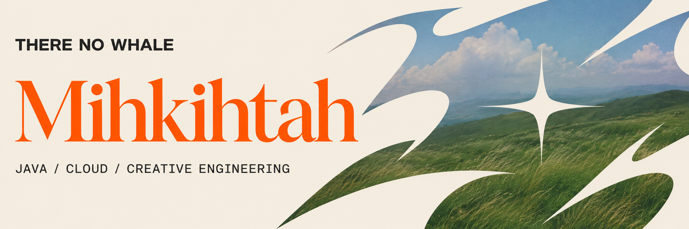

<strong>Mihkihtah · Java Cloud Engineer</strong>

Backend systems, cloud infrastructure and independent products. Learning by building. Sharing the process.

  <a href="https://github.com/therenowhale?tab=repositories">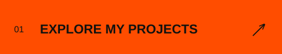</a>
  <a href="https://github.com/swagalabs">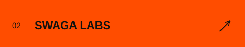</a>

 

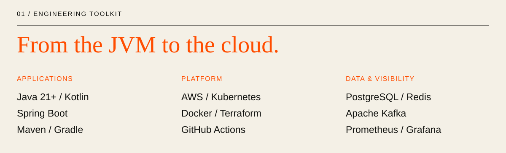

 

### In the lab

  <a href="https://github.com/swagalabs">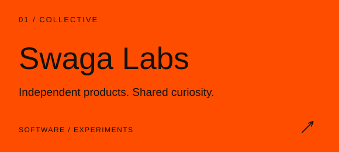</a>
  <a href="https://swagalabs.github.io/murhub.docs/">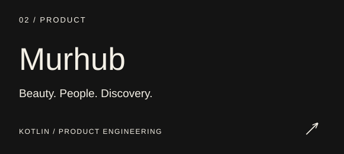</a>

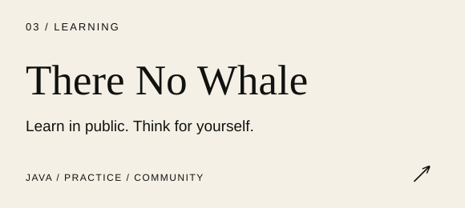

| Project | What I'm exploring |
| :--- | :--- |
| [Swaga Labs](https://github.com/swagalabs) | Building independent products together. |
| [Murhub](https://swagalabs.github.io/murhub.docs/) | Connecting people with beauty professionals through their work and individual style. |
| There No Whale | Hands-on Java learning, engineering experiments and sharing what I discover. |

 

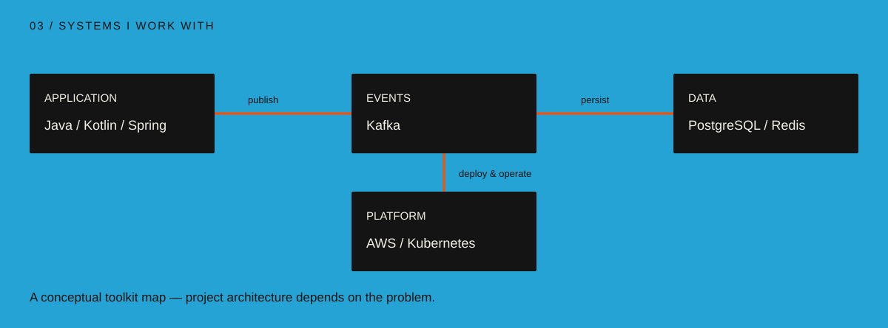

 

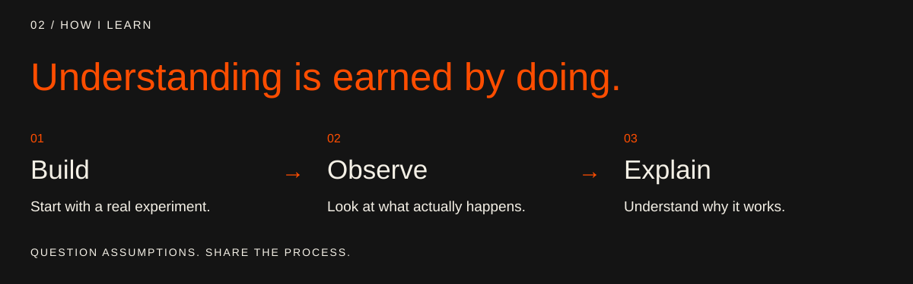

Behind the experiments

I like understanding what happens underneath an abstraction. I learn by building a small experiment, inspecting the result and explaining it in my own words.

There No Whale is a place to question assumptions and learn alongside other developers. The process matters: the mistakes, the working code and the understanding that comes from both.

 

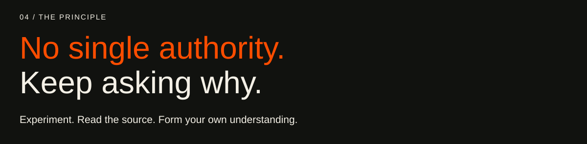

 

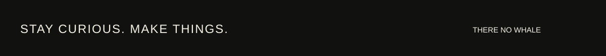
