
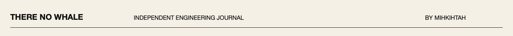

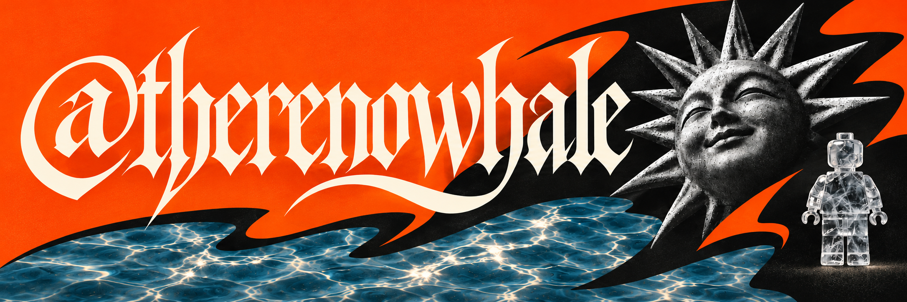

<strong>Java / Kotlin / Cloud</strong> Independent products. Hands-on experiments. Thinking for yourself.

  <a href="https://github.com/therenowhale?tab=repositories">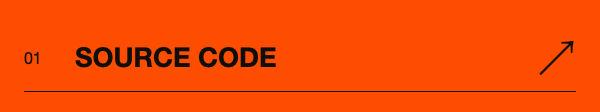</a>
  <a href="https://github.com/swagalabs">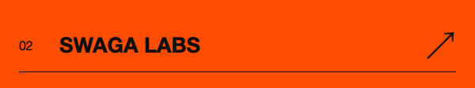</a>
  <a href="https://swagalabs.github.io/murhub.docs/">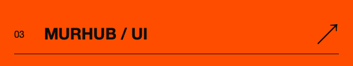</a>

<a href="#engineering">01 — Engineering</a> &nbsp; / &nbsp; <a href="#experiments">02 — Experiments</a> &nbsp; / &nbsp; <a href="#in-the-lab">03 — In the lab</a>

 

  <a href="#engineering">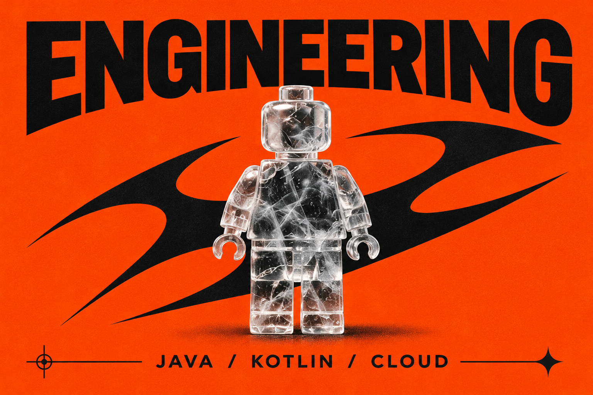</a>
  <a href="#experiments">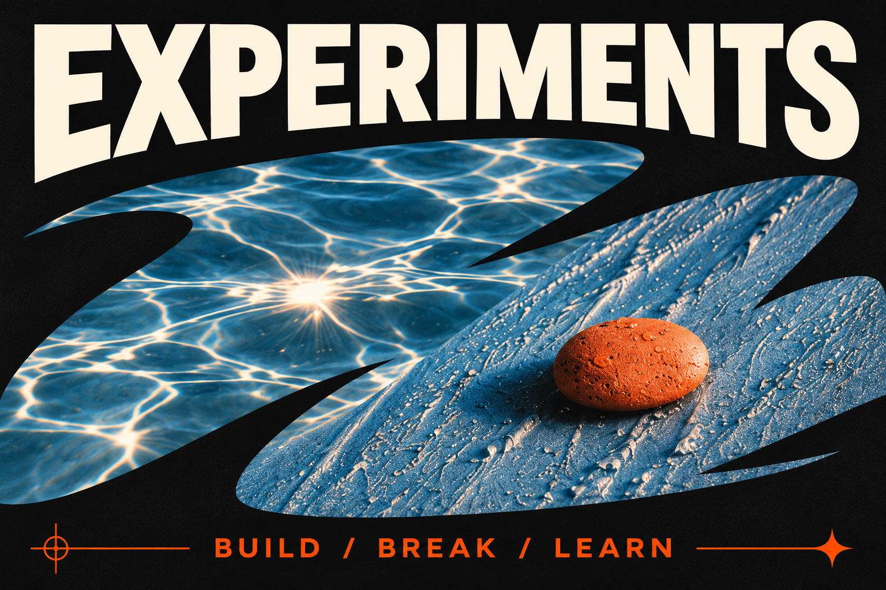</a>
  <a href="#in-the-lab">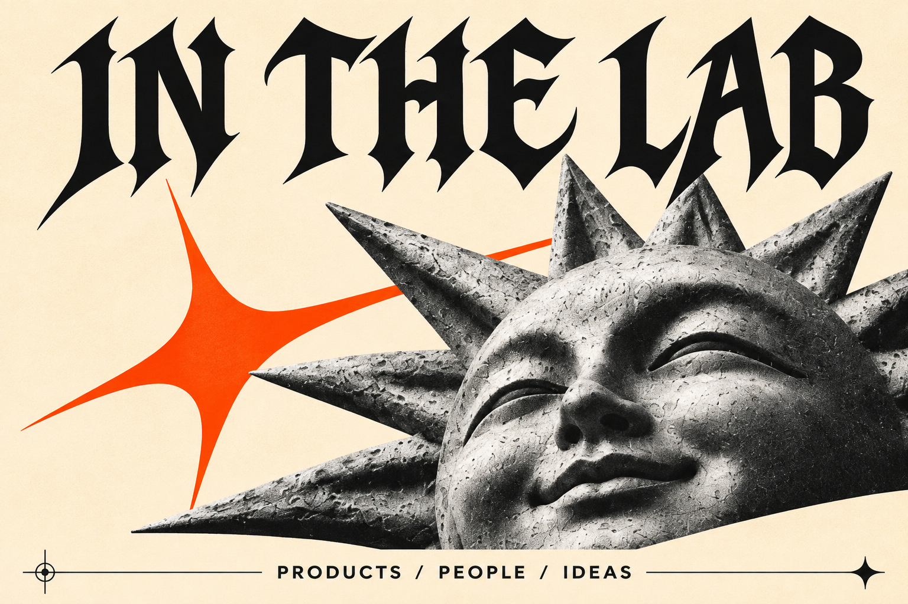</a>

## Engineering

I build backend systems and work with cloud infrastructure. I like following a problem from application code through data, deployment and observability.

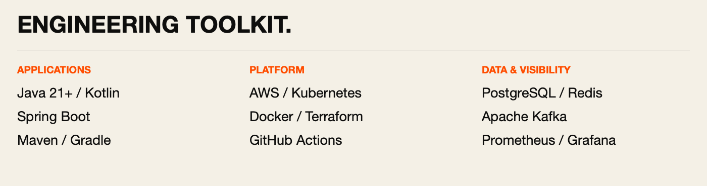

Read the toolkit as text

- **Applications:** Java 21+, Kotlin, Spring Boot, Maven, Gradle.
- **Platform:** AWS, Kubernetes, Docker, Terraform, GitHub Actions.
- **Data & visibility:** PostgreSQL, Redis, Apache Kafka, Prometheus, Grafana.

 

## Experiments

Small experiments make abstractions tangible. Build something, inspect what happens, then explain the mechanism in your own words.

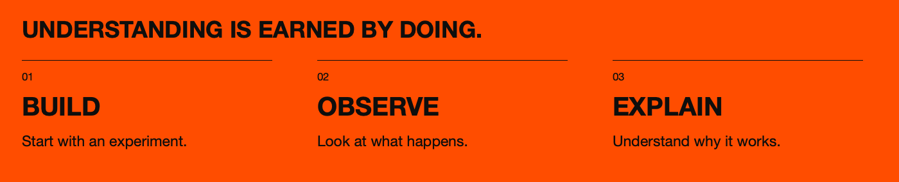

## In the lab

### [Swaga Labs ↗](https://github.com/swagalabs)

A shared space for independent products and engineering experiments. Building things together, from a first idea to working software.

### [Murhub ↗](https://swagalabs.github.io/murhub.docs/)

Helping people discover beauty professionals through their work and individual style. Kotlin, product engineering and a lot of questions worth testing.

[API reference](https://swagalabs.github.io/murhub-api/) · [Interface explorations](https://swagalabs.github.io/murhub.docs/)

### There No Whale

Learning backend engineering in public: experiments, working code and lessons from the process. A place to question assumptions and learn alongside other developers.

 

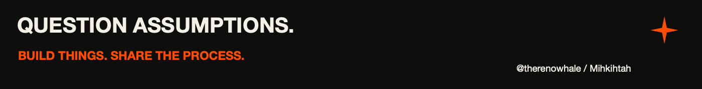
